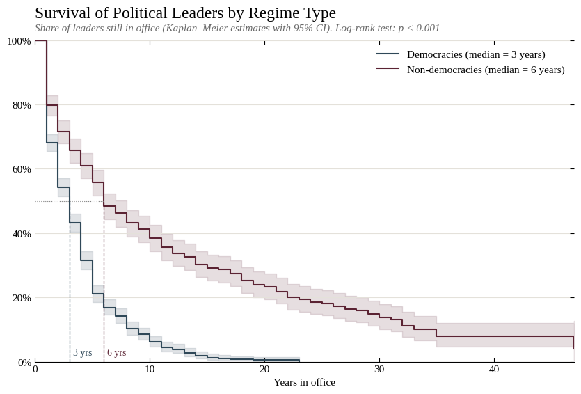

# Lab 2: Survival Analysis of Political Leaders' Time in Office

**Course:** QMSS GR5016 – Time Series, Panel Data & Forecasting  
**Author:** Savannah Estridge  
**Term:** Columbia University - Fall 2026  

> **For the full analysis and code, see [`survival_analysis_example.ipynb`](survival_analysis_example.ipynb).**

**Democracy VS Dictatorship Survival Analysis**

Survival analysis, also known as time-to-event analysis, is a set of statistical methods that address two related questions: how long it takes for an event to occur, and which factors increase or decrease the risk of that event. Using the Democracy and Dictatorship dataset (Cheibub, Gandhi & Vreeland, 2010), available in the lifelines package, I conduct a survival analysis of how long political leaders remain in office and which factors make them more or less likely to leave power.

### Dataset Description

The Democracy and Dictatorship dataset contains **1,808 leader spells** across 12 variables, covering **200 countries** from 1946 (or a country's independence) through 2008. Each observation is one leader's continuous spell in office under a single regime type, which serves as the **unit of analysis** in this survival analysis.

For each spell, the data record a **duration** (`duration`, the number of years the leader remained in office) and an **event indicator (failure variable)** (`observed`), which shows whether the leader left office during the observation window (**1 = event**) or was **right-censored** (**0**). Censored spells belong to leaders who died in office or were still in office at the end of the observation window in 2008.

The dataset also includes **covariates** that may affect the **hazard** of leaving office. The main covariate is regime type: democracies are classified as parliamentary, mixed (semi-presidential), or presidential, and dictatorships as military, civilian, or monarchy. Additional covariates include the country's geographic region and continent.

This analysis examines how regime type affects how long political leaders remain in office. I hypothesize that leaders in non-democracies have longer survival times than leaders in democracies; that is, they face a lower hazard of leaving office. Democracies hold regular, competitive elections and often impose term limits, which create routine opportunities for leaders to lose or give up power. Leaders in non-democracies face fewer of these constraints.

Below is a data dictionary:

### Data Dictionary (`lifelines.datasets.load_dd`)

| Variable Name | Data Type | Role / Category | Coding Details & Allowed Values | Description |
| :--- | :--- | :--- | :--- | :--- |
| **`ctryname`** | String (`object`) | Identifier | Country name strings (e.g., `"Afghanistan"`, `"Argentina"`) | The name of the sovereign country being observed. |
| **`cowcode2`** | Integer (`int64`) | Country Code | Numeric Correlates of War (COW) codes | Standard political science numeric identifier for countries. |
| **`politycode`** | Float (`float64`) | Country Code | Numeric Polity IV country codes (contains missing/`NaN` values) | Alternative country code identifier from the Polity IV project dataset. |
| **`un_region_name`** | String (`object`) | Geographic | UN subregion strings (e.g., `"Southern Asia"`, `"Western Europe"`) | Geographic subregion classification defined by the United Nations. |
| **`un_continent_name`** | String (`object`) | Geographic | `"Africa"`, `"Americas"`, `"Asia"`, `"Europe"`, `"Oceania"` | Continent classification defined by the United Nations. |
| **`ehead`** | String (`object`) | Identifier | Leader name strings (e.g., `"Mohammad Zahir Shah"`) | The name of the effective head of government during the observed spell. |
| **`leaderspellreg`** | String (`object`) | Composite ID | Format: `[Leader Name].[Country].[Start Year].[End Year].[Regime]` | Unique string code mapping the leader, country, active years, and regime classification. |
| **`democracy`** | String (`object`) | Predictor (Binary) | `"Democracy"` or `"Non-democracy"` | Binary classification of whether the regime meets minimalist democratic criteria (contested elections and alternation in power). |
| **`regime`** | String (`object`) | Predictor (Categorical) | `"Parliamentary Dem"`, `"Mixed Dem"`, `"Presidential Dem"`, `"Civilian Dict"`, `"Military Dict"`, `"Royal Dict"` | Six-category institutional classification distinguishing democratic legislative systems and authoritarian ruler profiles. |
| **`start_year`** | Integer (`int64`) | Temporal | Calendar years (`1946` to `2008`) | The calendar year in which the specific leader/regime spell began. |
| **`duration`** | Integer (`int64`) | **Duration (Time)** | Positive integers (`1` to `47`) | **Time-to-event variable:** Total number of consecutive years the leader or regime remained in power during the study window. |
| **`observed`** | Integer (`int64`) | **Event Indicator** | `1` = Event observed (spell ended) `0` = Right-censored (still in power at study cutoff) | **Status variable:** Code showing whether the leader/regime exited office during the tracking period (`1`) or remained active when observation ended in 2008 (`0`). |

### Survival Analysis Setup

| Component | Variable | Definition |
|---|---|---|
| **Unit of analysis** | `leaderspellreg` | One leader's continuous spell in office under a single regime type |
| **Observation window** | — | 1946–2008 (or from a country's independence) |
| **Start point (origin)** | `start_year` | Year the leader took office, when the leader enters the risk set |
| **Duration** | `duration` | Years the leader remained in office during the observation window |
| **Event (failure)** | `observed` = 1 | The leader left office during the observation window (1,468 spells) |
| **Right-censored** | `observed` = 0 | The leader died in office or was still in office in 2008 (340 spells, 18.8%) |
| **Left-truncated** | `start_year` = 1946 | Leaders already in office when observation began; their true durations may be understated (70 spells) |
| **Covariates** | `regime`, `democracy`, `un_continent_name` | Characteristics that may raise or lower the hazard of leaving office |

Survival analysis accounts for **censored data**: cases in which a subject was at risk of the event but did not experience it while under observation, either because the observation window closed first or because the subject left the risk set for another reason (E.G: they died while in office). In this dataset, leaders still in office at the end of 2008 and leaders who died in office are **right-censored**. Censored spells still contribute information: each counts as at risk for every year it was observed, then leaves the risk set without the event.

The **Risk window** is from 1946–2008, the years observed in the dataset (or from a country's independence). Each regime itself is at risk from their specific `start_year`.

### Methods

This analysis uses three survival methods that build on one another: a descriptive estimate of survival over time, a formal test of whether two groups differ, and a regression model that measures the size of that difference.

**1. Kaplan–Meier estimator**

*What it is:* The Kaplan–Meier (KM) estimator is a non-parametric method for estimating the survival function, S(t): the probability that a subject has not yet experienced the event by time t. At each time point where an event occurs, it calculates the share of subjects still at risk who survive past that point, then multiplies these conditional probabilities together over time. This produces a step function that drops at each observed event.

*Why it is used:* KM makes no assumptions about the shape of the survival distribution, so it gives an unbiased first look at the data. It also handles censoring correctly. A censored leader counts as at risk for every year they were observed, then leaves the risk set without counting as an event. Simply averaging spell lengths would understate how long leaders stay in office, because censored leaders' spells were cut short by the end of the data, not by leaving office.

*How it is applied here:* I estimate the survival curve first for all 1,808 leader spells, then separately for democracies and non-democracies. I report the median time in office (the point where the curve crosses 50%), survival at selected years, and 95% confidence intervals.

**2. Log-rank test**

*What it is:* The log-rank test is a non-parametric hypothesis test that compares survival curves across groups. At each event time, it compares the number of events observed in each group with the number expected if both groups shared the same survival curve. It then sums these differences over the whole follow-up period into a chi-squared statistic.

*Why it is used:* The KM curves show whether democracies and non-democracies look different, but not whether the gap could be due to chance. The log-rank test formally tests the null hypothesis that the two groups have identical survival functions. Because it weighs every event time equally, it evaluates the difference across the entire curve rather than at a single point in time.

*How it is applied here:* I compare the survival curves of democratic and non-democratic leaders. A significant result means regime type is associated with how long leaders remain in office.

**3. Cox proportional hazards model**

*What it is:* The Cox proportional hazards model is a semi-parametric regression model for survival data. It models the hazard, the instantaneous risk of the event at time t among subjects still at risk, as a baseline hazard multiplied by the exponential of a linear combination of covariates: h(t | X) = h₀(t) · exp(βX). The baseline hazard h₀(t) is left unspecified, while the coefficients β are estimated by partial likelihood. Exponentiating a coefficient gives a hazard ratio (HR).

*Why it is used:* The log-rank test shows that a difference exists, but not how large it is. The Cox model measures the size of the effect as a hazard ratio. An HR above 1 means a higher risk of leaving office, and an HR below 1 means a lower risk. It also allows additional covariates to be added in later models. Its key assumption is proportional hazards: the effect of each covariate on the hazard is constant over time.

*How it is applied here:* I fit a Cox model with a binary democracy indicator (1 = democracy, 0 = non-democracy). Many countries have multiple leader spells, and spells within the same country are not independent, so I cluster standard errors by country (`ctryname`) to get robust variance estimates. I report the hazard ratio, its 95% confidence interval, and the concordance index, which measures how well the model ranks leaders by who leaves office first (0.5 = random, 1.0 = perfect).

### Kaplan Meier Model

The Kaplan–Meier curve above shows the estimated probability that a leader remains in office after t years (x-axis), and the shaded band shows the 95% confidence interval. Of 1,808 leader spells, 1,468 ended with the leader leaving office and 340 (18.8%) were censored. The median time in office is four years. Spells ranged from one year to 47 years.

| | Value |
|---|---|
| Leader spells (N) | 1,808 |
| Events (left office) | 1,468 |
| Censored | 340 (18.8%) |
| Median time in office | 4 years |
| 95% CI for median | 3–4 years |

#### Survival summary

| Years in office | Number at risk | Survival | 95% CI lower | 95% CI upper |
|---:|---:|---:|---:|---:|
| 1 | 1808 | 0.722 | 0.701 | 0.742 |
| 2 | 1253 | 0.602 | 0.579 | 0.624 |
| 5 | 632 | 0.334 | 0.311 | 0.357 |
| 10 | 250 | 0.181 | 0.162 | 0.202 |
| 15 | 124 | 0.118 | 0.101 | 0.136 |
| 20 | 71 | 0.091 | 0.075 | 0.109 |
| 30 | 27 | 0.053 | 0.039 | 0.070 |

The table shows the estimated share of leaders still in office at selected time points. After one year, 72% of leaders remained in office; after two years, 60%; and after five years, 33%. Survival then declined more slowly: 18% of leaders remained after 10 years, 9% after 20 years, and 5% after 30 years. The number of leaders at risk fell from 1,808 at the start to 27 by year 30, so estimates at later time points are based on fewer leaders.

#### **Kaplan-Meier: Democracy VS Non-Democracy**

The Kaplan–Meier curves above show the estimated probability that a leader remains in office after t years (x-axis), comparing democracies and non-democracies. The data include 1,187 leader spells in democracies and 621 in non-democracies. At every point in time, leaders in non-democracies have a higher probability of remaining in office than leaders in democracies. The median time in office is 3 years for democratic leaders and 6 years for non-democratic leaders. After 20 years, an estimated 0.5% of democratic leaders remain in office, compared with 23% of non-democratic leaders.

#### Survival Summary: Democracy VS Non-Democracy

| | Democracy At risk | Democracy Survival | Democracy 95% CI lower | Democracy 95% CI upper | Non-democracy At risk | Non-democracy Survival | Non-democracy 95% CI lower | Non-democracy 95% CI upper |
|---:|---:|---:|---:|---:|---:|---:|---:|---:|
| 1 | 1187 | 0.682 | 0.654 | 0.707 | 621 | 0.799 | 0.765 | 0.828 |
| 2 | 774 | 0.542 | 0.513 | 0.571 | 479 | 0.715 | 0.678 | 0.749 |
| 5 | 302 | 0.211 | 0.186 | 0.236 | 330 | 0.558 | 0.517 | 0.597 |
| 10 | 57 | 0.062 | 0.046 | 0.080 | 193 | 0.385 | 0.343 | 0.426 |
| 15 | 10 | 0.013 | 0.006 | 0.024 | 114 | 0.292 | 0.252 | 0.333 |
| 20 | 3 | 0.005 | 0.001 | 0.015 | 70 | 0.233 | 0.194 | 0.274 |

Leaders in non-democracies had a higher estimated probability of remaining in office at every time point. After one year, 80% of non-democratic leaders were still in office, compared with 68% of democratic leaders. The gap widened over time: after five years, 56% of non-democratic leaders remained versus 21% of democratic leaders, and after ten years, 39% versus 6%. By year 20, about 23% of non-democratic leaders were still in office, compared with less than 1% of democratic leaders. The 95% confidence intervals for the two groups do not overlap at any time point, which is consistent with the significant log-rank test.

#### **Log-rank test**

| test_statistic | p | -log2(p) |
|---:|---:|---:|
| 260.47 | <0.005 | 192.23 |

A log-rank test showed that the survival curves of leaders in democracies and non-democracies differ significantly, χ²(1) = 260.47, p < 0.001. Leaders in non-democracies remained in office longer (median = 6 years) than leaders in democracies (median = 3 years), supporting the hypothesis.

### Cox-Proportional Hazards Methods

The Cox proportional hazards model is a regression method for survival data. It estimates how covariates affect the hazard, the risk that an event occurs at a given time among those still at risk, while accounting for censored cases. Each covariate’s effect is expressed as a hazard ratio: a value above 1 means a higher risk of the event (a shorter time to it), and a value below 1 means a lower risk (a longer time to it). The model does not require assumptions about how the baseline risk changes over time, but it does assume that each covariate’s effect on the hazard stays constant over time (the proportional hazards assumption).

| covariate | coef | exp(coef) | se(coef) | coef lower 95% | coef upper 95% | exp(coef) lower 95% | exp(coef) upper 95% | z | p |
|---|---:|---:|---:|---:|---:|---:|---:|---:|---:|
| democracy | 0.96 | 2.62 | 0.11 | 0.76 | 1.17 | 2.13 | 3.22 | 9.11 | <0.005 |

Concordance = 0.59 · Partial AIC = 19230.53 · log-likelihood ratio test = 264.03 on 1 df

A Cox proportional hazards model with standard errors clustered by country was used to estimate how regime type affects the hazard of leaving office. The hazard is the risk that a leader leaves office at a given point in time, among leaders who are still in office at that point. Leaders in democracies faced a significantly higher hazard of leaving office than leaders in non-democracies (HR = 2.62, 95% CI [2.13, 3.22], p < 0.001). At any given time, democratic leaders were about 2.6 times as likely to leave office as non-democratic leaders. The model’s concordance was 0.59, indicating that regime type alone modestly predicts which leaders leave office first.

### **Conclusion**

-----------------------

The results support the hypothesis that leaders in non-democracies remain in office longer than leaders in democracies. Non-democratic leaders had a median time in office of 6 years, compared with 3 years for democratic leaders, and the difference between their survival curves was statistically significant (χ²(1) = 260.47, p < 0.001). A Cox proportional hazards model showed that democratic leaders faced 2.62 times the hazard of leaving office (95% CI [2.13, 3.22], p < 0.001). These results show an association rather than a causal effect.
