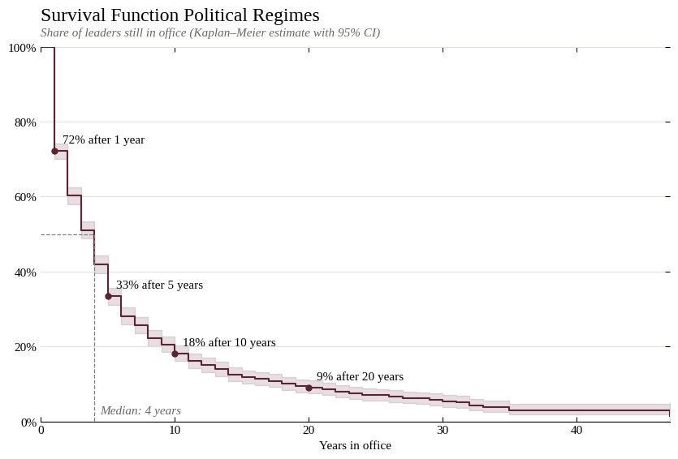

# Lab 2: Survival Analysis of Political Leaders' Time in Office

**Course:** QMSS GR5016 – Time Series, Panel Data & Forecasting
**Author:** Savannah Estridge
**Term:** Columbia University – Fall 2026

## Overview

Survival analysis (time-to-event analysis) asks two related questions: how long it takes for an event to occur, and which factors raise or lower the risk of that event. Using the Democracy and Dictatorship dataset (Cheibub, Gandhi & Vreeland, 2010), available in the `lifelines` package, this project analyzes how long political leaders stay in office and which factors make them more or less likely to leave power.

**Hypothesis:** Leaders in non-democracies survive longer in office than leaders in democracies, meaning they face a lower hazard of leaving. Democracies hold regular, competitive elections and often impose term limits, which give leaders routine occasions to lose or give up power. Leaders in non-democracies face fewer of these constraints.

## Data

The dataset contains **1,808 leader spells** with 12 variables, covering **200 countries** from 1946 (or a country's independence) through 2008. Each observation is one leader's continuous spell in office under a single regime type.

| Component | Variable | Definition |
|---|---|---|
| Unit of analysis | `leaderspellreg` | One leader's continuous spell in office under a single regime type |
| Observation window | — | 1946–2008 (or from a country's independence) |
| Origin | `start_year` | Year the leader took office and entered the risk set |
| Duration | `duration` | Years the leader stayed in office (1–47) |
| Event | `observed` = 1 | Leader left office during the window (1,468 spells) |
| Right-censored | `observed` = 0 | Leader died in office or was still in office in 2008 (340 spells, 18.8%) |
| Left-truncated | `start_year` = 1946 | Leaders already in office when observation began (70 spells) |
| Covariates | `regime`, `democracy`, `un_continent_name` | Characteristics that may change the hazard of leaving office |

<details>
<summary>Full data dictionary</summary>

| Variable | Type | Description |
| :--- | :--- | :--- |
| `ctryname` | string | Country name |
| `cowcode2` | int | Correlates of War country code |
| `politycode` | float | Polity IV country code (some missing) |
| `un_region_name` | string | UN subregion |
| `un_continent_name` | string | UN continent |
| `ehead` | string | Effective head of government |
| `leaderspellreg` | string | Leader.Country.StartYear.EndYear.Regime ID |
| `democracy` | string | `Democracy` or `Non-democracy` |
| `regime` | string | Parliamentary, Mixed or Presidential Dem; Civilian, Military or Royal Dict |
| `start_year` | int | Year the spell began (1946–2008) |
| `duration` | int | Years in office during the study window |
| `observed` | int | 1 = left office, 0 = right-censored |

</details>

## Methods

1. **Kaplan–Meier estimation** of the survival function for all leaders, then separately for democracies and non-democracies.
2. **Log-rank test** comparing the two survival curves.
3. **Cox proportional hazards model** with democracy as the covariate and standard errors clustered by country.

## Results

### 1. Overall survival (Kaplan–Meier)



| | Value |
|---|---|
| Leader spells (N) | 1,808 |
| Events (left office) | 1,468 |
| Censored | 340 (18.8%) |
| Median time in office | 4 years |
| 95% CI for median | 3–4 years |

| Years in office | At risk | Survival | 95% CI |
|---:|---:|---:|:---:|
| 1 | 1,808 | 0.722 | 0.701–0.742 |
| 2 | 1,253 | 0.602 | 0.579–0.624 |
| 5 | 632 | 0.334 | 0.311–0.357 |
| 10 | 250 | 0.181 | 0.162–0.202 |
| 15 | 124 | 0.118 | 0.101–0.136 |
| 20 | 71 | 0.091 | 0.075–0.109 |
| 30 | 27 | 0.053 | 0.039–0.070 |

Leaders leave office quickly at first and more slowly later. 72% remained after one year, 60% after two years and 33% after five. After that the decline flattens: 18% remained after 10 years, 9% after 20 and 5% after 30. Only 27 leaders were still at risk at year 30, so the later estimates rest on few observations.

### 2. Democracy vs. non-democracy


| Years | Democracy: at risk | Democracy: survival (95% CI) | Non-democracy: at risk | Non-democracy: survival (95% CI) |
|---:|---:|:---:|---:|:---:|
| 1 | 1,187 | 0.682 (0.654–0.707) | 621 | 0.799 (0.765–0.828) |
| 2 | 774 | 0.542 (0.513–0.571) | 479 | 0.715 (0.678–0.749) |
| 5 | 302 | 0.211 (0.186–0.236) | 330 | 0.558 (0.517–0.597) |
| 10 | 57 | 0.062 (0.046–0.080) | 193 | 0.385 (0.343–0.426) |
| 15 | 10 | 0.013 (0.006–0.024) | 114 | 0.292 (0.252–0.333) |
| 20 | 3 | 0.005 (0.001–0.015) | 70 | 0.233 (0.194–0.274) |

At every time point, leaders in non-democracies were more likely to still be in office. The median time in office was **3 years for democratic leaders** and **6 years for non-democratic leaders**. The gap widens over time: at five years, 56% of non-democratic leaders remained against 21% of democratic leaders, and by year 20 it was about 23% against under 1%. The 95% confidence intervals do not overlap at any time point.

### 3. Log-rank test

| Test statistic (χ², 1 df) | p |
|---:|---:|
| 260.47 | < 0.001 |

The two survival curves differ significantly, χ²(1) = 260.47, p < 0.001.

### 4. Cox proportional hazards model

Model: hazard of leaving office ~ democracy (1 = democracy, 0 = non-democracy), with standard errors clustered by country.

| Covariate | Coef | HR | 95% CI (HR) | SE (robust) | z | p |
|---|---:|---:|:---:|---:|---:|---:|
| democracy | 0.96 | **2.62** | 2.13–3.22 | 0.11 | 9.11 | < 0.001 |

Concordance = 0.59 · Partial AIC = 19,230.53 · Likelihood-ratio test = 264.03 on 1 df

At any point in time, democratic leaders were about **2.6 times as likely** to leave office as non-democratic leaders still in power. A concordance of 0.59 means regime type alone predicts only modestly which leaders leave first.

## Conclusion

The results support the hypothesis. Non-democratic leaders stayed in office longer (median 6 years against 3), the survival curves differed significantly (χ²(1) = 260.47, p < 0.001), and democratic leaders faced 2.62 times the hazard of leaving office (95% CI 2.13–3.22, p < 0.001). These results show an association, not a causal effect.

## Reproducing the analysis

```bash
pip install lifelines pandas matplotlib
jupyter notebook survival_analysis_example.ipynb
```

The dataset loads directly with `lifelines.datasets.load_dd()`.

## Reference

Cheibub, J. A., Gandhi, J., & Vreeland, J. R. (2010). Democracy and dictatorship revisited. *Public Choice*, 143(1–2), 67–101.
